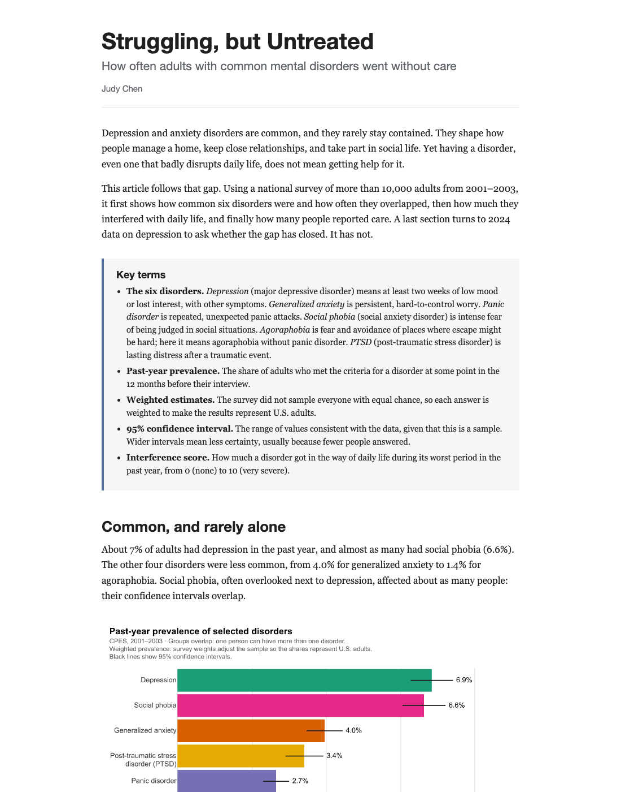

# CAPP 30239: Data Visualization for Policy Analysis

Judy Chen

Course assignments and projects.

## Current submission: Static Visualization, Final

### Mental disorders, daily-life interference, and reported care

#### Description

This project compares six mental disorders: how common they were, how often they occurred together, how much they interfered with daily life, and what care people reported. Most figures use the Collaborative Psychiatric Epidemiology Surveys (2001–2003); the last three use the 2024 National Survey on Drug Use and Health to look at depression more recently.



#### Data Sources

- Alegría, Margarita, James S. Jackson, Ronald C. Kessler, and David Takeuchi. *Collaborative Psychiatric Epidemiology Surveys (CPES), 2001–2003 [United States].* ICPSR 20240, version 9. Inter-university Consortium for Political and Social Research. https://www.icpsr.umich.edu/web/ICPSR/studies/20240
- Substance Abuse and Mental Health Services Administration. *National Survey on Drug Use and Health 2024 (NSDUH-2024-DS0001)*, public-use file. https://www.samhsa.gov/data/data-we-collect/nsduh-national-survey-drug-use-and-health/datafiles/2024

#### Files

- [Final article (PDF)](static-viz-project/final/final.pdf) · [HTML version](static-viz-project/final/final.html)
- [Notebook: code that generates all figures](static-viz-project/static_viz.ipynb)
- [Project README: run instructions](static-viz-project/README.md)

## Repository map

```text
.
├── README.md
├── altair-lab/
│   └── altair_lab.ipynb
└── static-viz-project/
    ├── README.md
    ├── pyproject.toml
    ├── static_viz.ipynb      code for all figures
    ├── data/                 local files; download instructions inside
    ├── milestones/
    │   ├── static-proposal.md
    │   ├── static-draft.md   milestone 2, as submitted
    │   └── draft-figures/
    └── final/                <<< CURRENT SUBMISSION
        ├── final.pdf         the article (submission)
        ├── final.html        the article's source
        ├── screenshot.png
        ├── write-up.md
        ├── AI.md
        └── figures/
```

## Other submissions

- [Altair Lab](altair-lab/altair_lab.ipynb)
- [Static Visualization, Milestone 1: Proposal](static-viz-project/milestones/static-proposal.md)
- [Static Visualization, Milestone 2: Draft](static-viz-project/milestones/static-draft.md)
