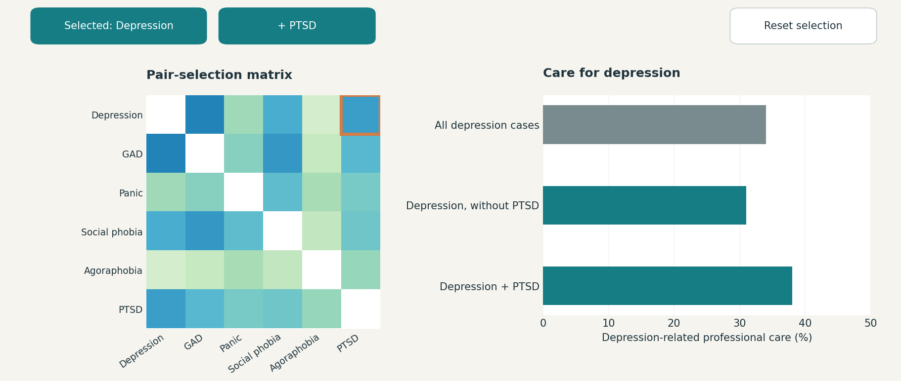
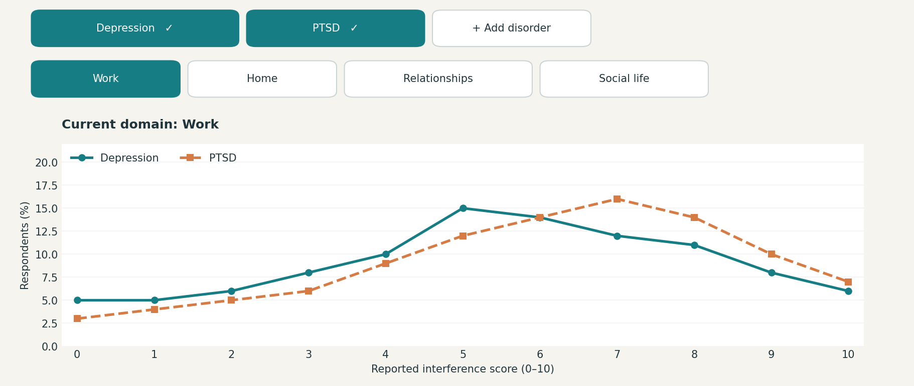
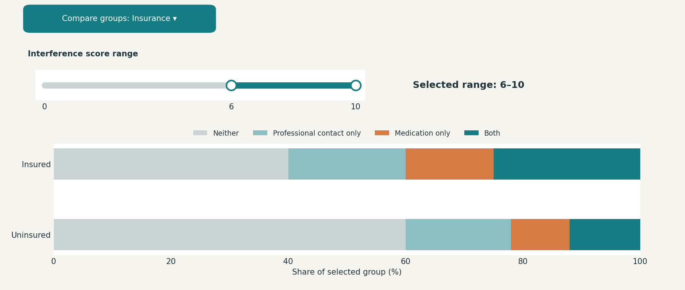

# Judy Chen

## Description

I plan to build an interactive project about mental health and access to care, reusing the CPES 2001–2003 and NSDUH 2024 datasets from my static visualization project.

The project is for general readers who want to understand mental health beyond disorder names. My main question is: how do disorders overlap, affect daily life, and relate to reported care? Readers will explore these relationships through their own comparisons.

## Technical Plan: Option B

I do not have many new ideas for interaction yet, so I am starting by building on my static plots. These are initial ideas, and I plan to explore new ways for readers to interact with the data in later submissions.

I chose Option B because my data covers several aspects of mental health, including prevalence, co-occurrence, daily-life interference, and care. One large visualization could blur these different results. Separate interactive charts would give readers more room to explore each aspect.

I also want to start with a short matching activity to draw readers into the topic. Readers could match symptom descriptions with disorder names, then see an explanation. This would introduce the terminology before moving into the survey results. The exact format is still undecided.

The main section will include at least three visualizations, with controls in at least two—for example, selecting disorders or comparing care across groups.

The three planned views are a selectable co-occurrence matrix with a linked care chart, interference-score distributions with disorder and life-domain controls, and a care comparison filtered by interference score.

I am considering Altair/Vega-Lite for the charts, embedded in an HTML/CSS page, with JavaScript for the matching activity and any controls that need it. The library choice is still tentative.

### Inspiration

1. **[Wordwall — Match Up](https://wordwall.net/):** Players drag terms next to their matching definitions. I could use this layout for readers to match disorder names with short symptom descriptions, then check their answers.

2. **[Wordwall — Matching Pairs](https://wordwall.net/resource/81597861/match-the-words-to-their-definitions):** Readers select related pairs of terms and descriptions. This offers an alternative to dragging: click a symptom-description card, then its matching disorder.

3. **[Gapminder — Bubble Chart](https://www.gapminder.org/tools/):** Readers select countries and change the measures shown in the chart. I want to borrow that ability to choose what to compare: readers could select disorders and switch between life domains, rather than see only the comparisons I picked.

The Wordwall examples inform the opening activity; Gapminder informs the main data exploration.

## Mockup

After the short matching-game introduction, readers will explore how mental disorders overlap, affect daily life, and relate to reported care. Rather than follow one fixed comparison, they can select disorders, switch measures, and compare groups.

The three mockups below show possible layouts and interactions. Their values are illustrative.

### 1. Which disorders occur together?

Readers select a pair of disorders in a co-occurrence matrix. A companion chart compares care for one selected disorder between people with and without the second disorder. The same care question is used for both groups.

**Example:** Click the square for depression and PTSD. The bars compare depression-related professional care among people with depression but without PTSD, people with both disorders, and all eligible depression cases. “Without PTSD” does not exclude other disorders.

These comparisons will include only respondents eligible for the same care question with a known answer. I will check question eligibility before finalizing each comparison; missing answers will not count as no care.

### 2. Where is daily life most affected?

Readers choose disorders and switch between work, home, relationships, and social life. The chart shows the distribution of interference scores, revealing differences that averages might hide.

**Example:** Select depression and PTSD, then click **Home** instead of **Work**. Both lines update to show interference with home life.

### 3. Does greater interference correspond to more care?

Readers select an interference-score range and compare care across groups. The chart shows the proportions reporting professional contact, medication, both, or neither.

**Example:** Drag the slider handles to select scores from 6 to 10. The bars update to compare care among insured and uninsured adults within that range. The dropdown lets readers choose another group comparison.

The first two sections will use CPES. The third will use NSDUH 2024 as a separate analysis. Filtered results will include respondent counts, with small samples flagged.

## Data Sources

I have already downloaded and explored both datasets for my static visualization project. The dimensions below refer to the full source files.

### Data Source 1: Collaborative Psychiatric Epidemiology Surveys (CPES), 2001–2003

URL: https://doi.org/10.3886/ICPSR20240.v9

Size: 20,013 rows, 5,543 columns

CPES combines NCS-R, NLAAS, and NSAL respondent-level surveys. It includes disorder classifications, daily-life interference, care, and demographics. The static project explored disorder prevalence, overlap, interference, and reported care. Its main treatment analysis used the NCS-R Part 2 and NLAAS sample of 10,341 respondents because question eligibility differs by survey. The interactive will need appropriate survey weights and eligibility checks as well.

I will reuse disorder classifications, interference scores for each life domain, and reported professional care for the overlap and daily-life sections.

### Data Source 2: National Survey on Drug Use and Health (NSDUH), 2024

URL: https://www.samhsa.gov/data/data-we-collect/nsduh-national-survey-drug-use-and-health/datafiles/2024

Size: 58,633 rows, 2,632 columns

NSDUH includes depression, functional impairment, treatment, and demographics. The static project examined adult depression and reported care using this dataset. Differences in questionnaires and disorder definitions mean CPES and NSDUH should remain separate analyses rather than a direct time trend.

I will focus on adults with past-year major depressive episodes, using depression-related interference, professional contact, medication, and insurance status for the care comparison.

## Questions

1. Do these interactions help readers learn more than they would from my static plots? Which interactions would you suggest improving or changing?
2. Is this plan manageable and enough to meet the requirements for Option B?
3. If readers filter the data down to a small group, how many respondents should remain before I show a comparison?
