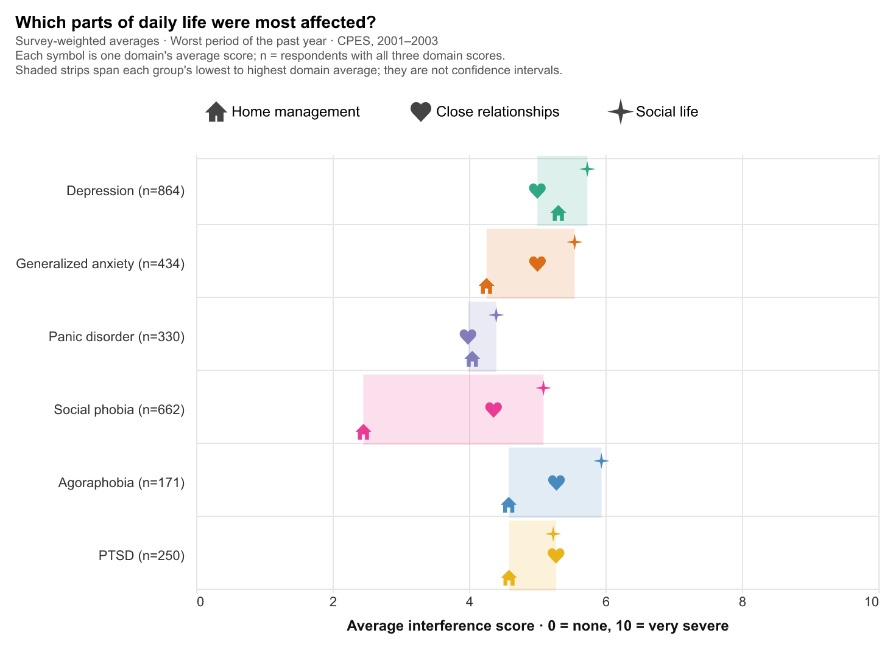

# Mental disorders, daily-life interference, and reported care

Judy Chen

## Description

This project compares six mental disorders: how common they were, how often they occurred together, how much they interfered with daily life, and what care people reported. Most figures use the Collaborative Psychiatric Epidemiology Surveys (2001–2003); the last three use the 2024 National Survey on Drug Use and Health to look at depression more recently.



## Data Sources

- Alegría, Margarita, James S. Jackson, Ronald C. Kessler, and David Takeuchi. *Collaborative Psychiatric Epidemiology Surveys (CPES), 2001–2003 [United States].* ICPSR 20240, version 9. Inter-university Consortium for Political and Social Research. https://www.icpsr.umich.edu/web/ICPSR/studies/20240
- Substance Abuse and Mental Health Services Administration. *National Survey on Drug Use and Health 2024 (NSDUH-2024-DS0001)*, public-use file. https://www.samhsa.gov/data/data-we-collect/nsduh-national-survey-drug-use-and-health/datafiles/2024

The raw files are not in this repository; [data/README.md](data/README.md) explains how to download them.

## Running the code

With the two data files in `data/`, run from this folder:

```sh
uv sync
uv run jupyter nbconvert --to notebook --execute --inplace src/static_viz.ipynb
```

This runs [src/static_viz.ipynb](src/static_viz.ipynb) from top to bottom and saves every figure to `static-viz/figures/`.

## Folders

- `data/`: download instructions; the raw survey files stay local.
- `milestones/`: the proposal and the milestone 2 draft with its original figures, as submitted.
- `scratch/`: ungraded experiments.
- `src/`: the notebook that generates all figures.
- `static-viz/`: the final figures, write-up, and AI-use disclosure.
