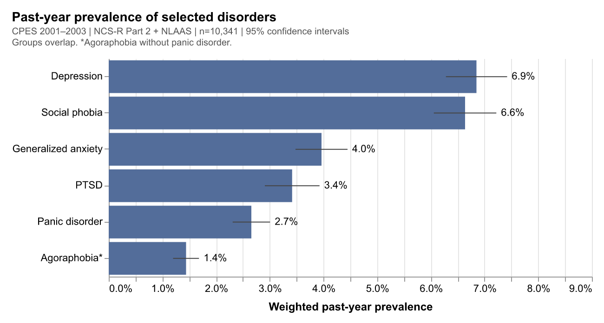
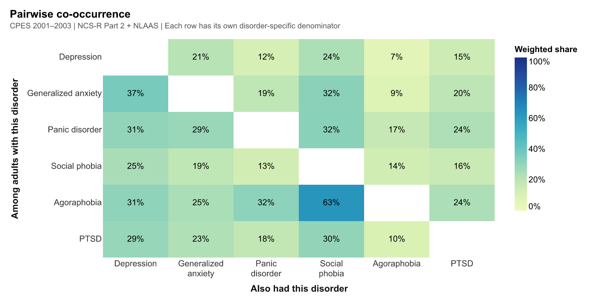
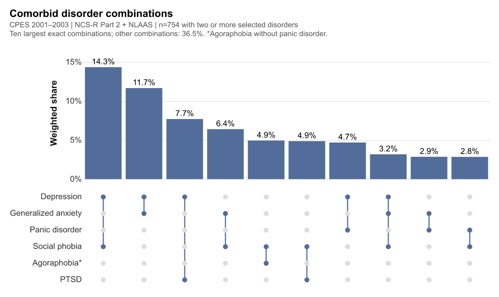
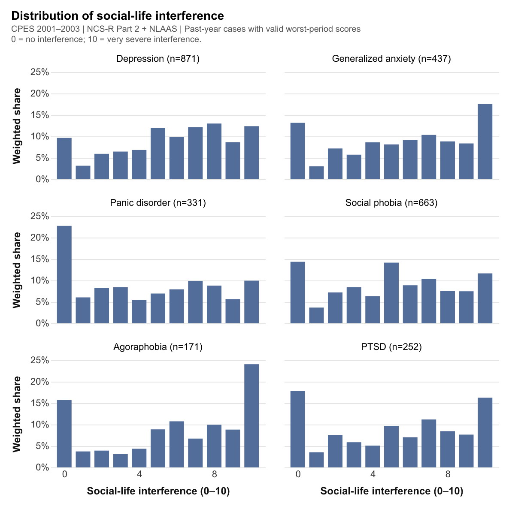
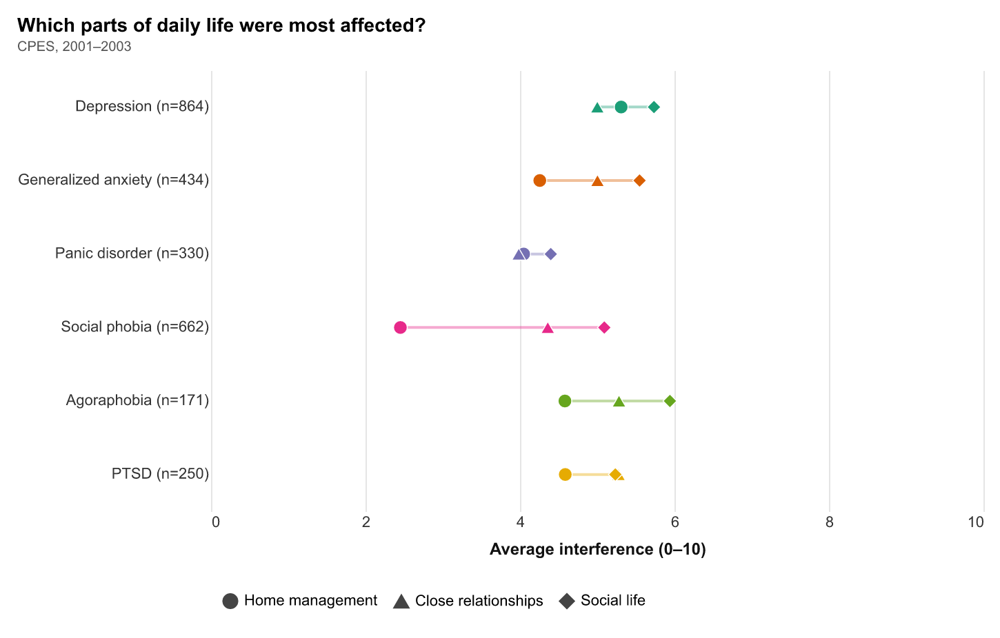
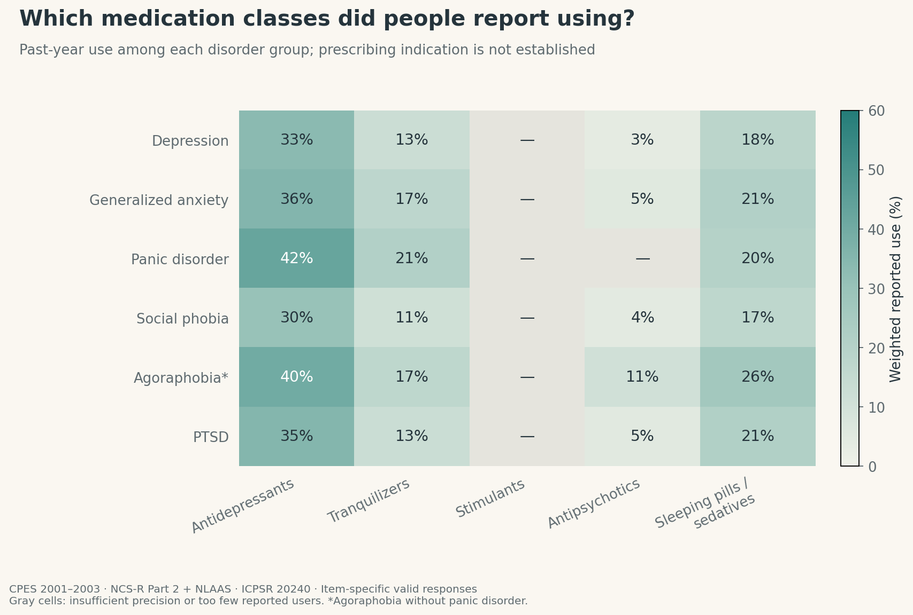
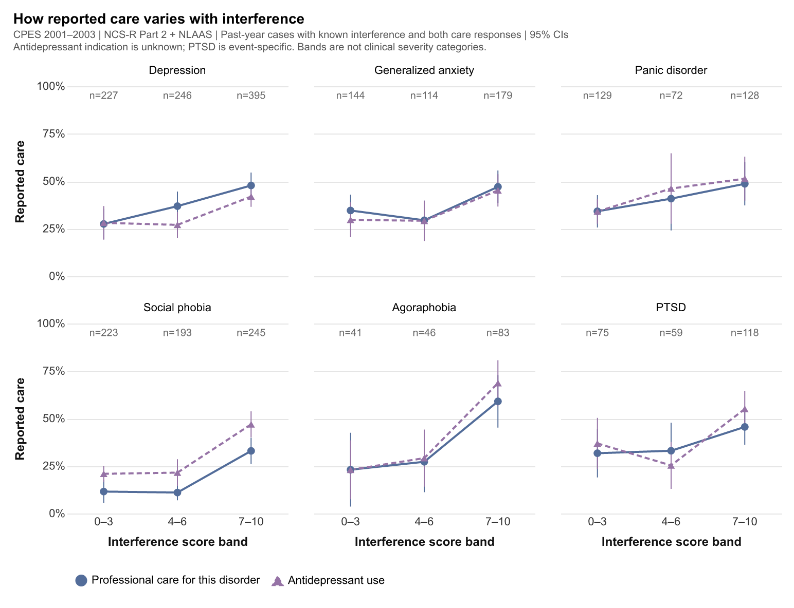
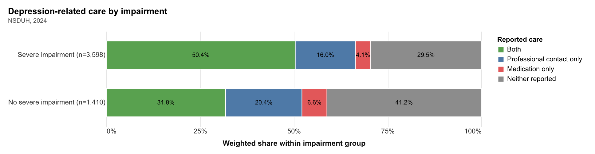
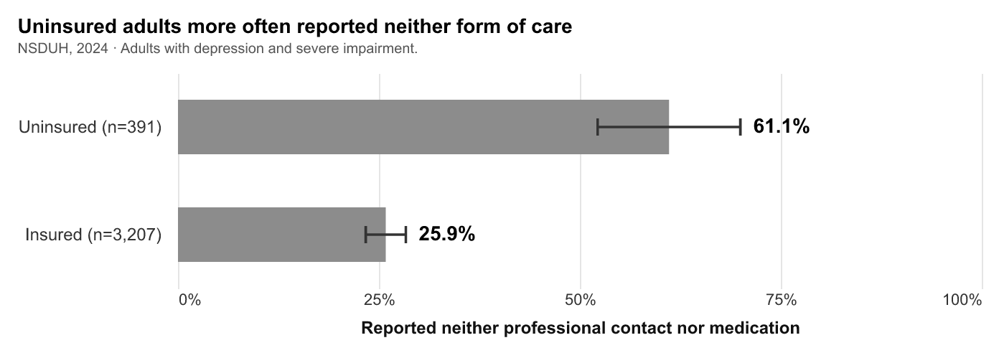
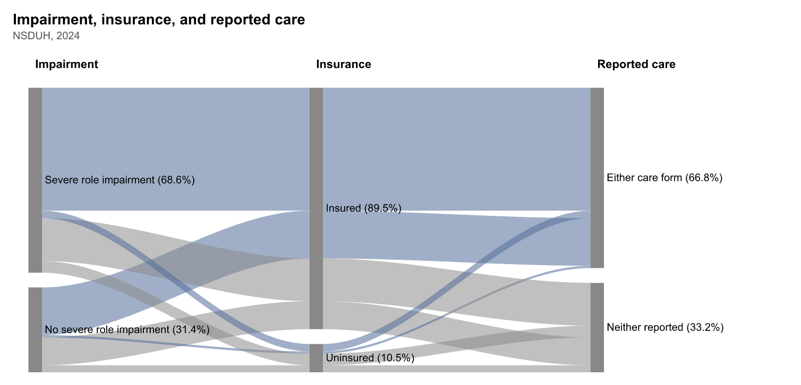

# Mental disorders, daily-life interference, and reported care

Judy Chen

## What is your current goal? Has it changed since the proposal?

My goal is still to explore the prevalence of selected mental disorders, their interference with daily life, and reported care. CPES 2001–2003 provides the main analysis, while NSDUH 2024 adds a separate section on depression, impairment, and insurance. The draft contains ten main figures and one optional alluvial experiment.

## Are there data challenges you are facing? Are you currently depending on mock data?

All figures use real data. CPES contains 20,013 respondents, with 10,341 in the shared analysis pool; NSDUH contains 58,633 respondents, including 5,205 adults with past-year depression.

The main challenges are questionnaire skips and missing responses. PTSD care and interference questions cover a narrower response subset, so those results cannot be generalized to every PTSD case. NSDUH has 197 depression cases with unknown care status, including 145 with severe impairment. The two surveys use different instruments and are not a direct historical trend.

Figures 01–08 use the NCS-R Part 2 + NLAAS pool. All percentages and averages use survey weights; n counts respondents, and error bars show 95% confidence intervals. Interference scores describe the worst period of the past year, from 0 (none) to 10 (very severe), and each chart uses eligible respondents with known answers.

Throughout this draft, agoraphobia refers to the diagnosis without panic disorder.

## Describe each of the provided images with 2-3 sentences to give the context and how it relates to your goal.

### Figure 01: Past-year prevalence

Major depression and social phobia had the highest prevalence among the six selected disorders. These overlapping groups introduce the scale of the historical mental-health burden.

### Figure 02: Which disorders occurred together?

Each row shows how often adults with one disorder also had each of the other disorders. The percentages use different denominators across rows, so the grid is not symmetric; it provides an overview before examining exact combinations.

### Figure 03: Which disorder combinations were most common?

The bars show the ten most common exact combinations among 754 respondents with at least two of the six selected disorders; other combinations account for 36.5%. Colored dots indicate disorders present and pale gray dots indicate disorders absent, with faint row bands repeating the disorder colors. The first bar represents depression and social phobia without any of the other four selected disorders.

### Figure 04: Social-life interference distributions

Each shaded row shows the weighted percentage reporting each social-life interference score from 0 to 10, with percentage labels inside the row and the same 0–25% vertical scale. Dots show the observed percentages, and curves connect them as visual guides between the whole-number scores. This reveals variation within disorder groups that a single average would hide.

### Figure 05: Daily-life domains

Each row compares weighted average interference across home management, close relationships, and social life using respondents with complete responses in all three domains. Marker shapes identify the domains, and each connecting line spans the lowest and highest domain averages on a shared 0–10 axis. Social phobia shows a particularly large difference, with average interference of 2.5 for home management and 5.1 for social life.

### Figure 06: Disorder-specific professional care

Reported past-year professional care was lower for social phobia than for the other selected disorders. The labels show how many cases had known care status, with PTSD representing a narrower event-specific response subset.

### Figure 07: Medication classes

Antidepressants were the most frequently reported of these medication classes within each disorder group. The chart does not identify the prescribing indication. The percentages are exploratory descriptions; some medication estimates are based on relatively few reported users.

### Figure 08: Interference and reported care

Each panel compares professional care (solid circles) and antidepressant use (dashed triangles) across three social-life interference bands, using the same respondents for both measures; counts appear beneath the score labels, and faint backgrounds identify each disorder. Both forms were reported more often in the highest band than in the lowest band in all six panels, although small samples produce wide confidence intervals and the bands are not clinical severity categories. Professional care refers to the specified disorder, while antidepressant use could be for another condition; these are overlapping measures, not mutually exclusive treatment groups.

### Figure 09: Depression-related care in 2024

The bars compare professional contact and prescription medication for depressive feelings among adults with and without severe role impairment, using the 5,008 cases with known care status. Neither form was reported by 29.5% of the severe-impairment group and 41.2% of the group without severe impairment.

### Figure 10: Insurance and reported care

Among adults with depression and severe impairment, 61.1% of uninsured adults reported neither care form, compared with 25.9% of insured adults. Bar lengths show the percentages and dark capped lines show 95% confidence intervals, and the comparison describes an association rather than an insurance effect.

### Figure 11: Optional experiment — impairment, insurance, and care

The ribbons connect impairment, insurance, and reported care categories within the same analysis population. Their widths show population shares rather than within-group rates or a treatment sequence; I am keeping this as an optional experiment because the crossing ribbons may be harder to read than the preceding insurance comparison.

## What form do you envision your final narrative taking? (e.g. An article incorporating the images? A poster? An infographic?)

An HTML or PDF article moving from prevalence and overlap to interference and care, followed by a separately labeled 2024 section on depression and insurance.

Sources: [CPES, ICPSR 20240](https://www.icpsr.umich.edu/web/ICPSR/studies/20240) and [NSDUH 2024](https://www.samhsa.gov/data/data-we-collect/nsduh-national-survey-drug-use-and-health/datafiles/2024). Code and local-data instructions are in the [notebook](static-draft.ipynb) and [README](README.md).
