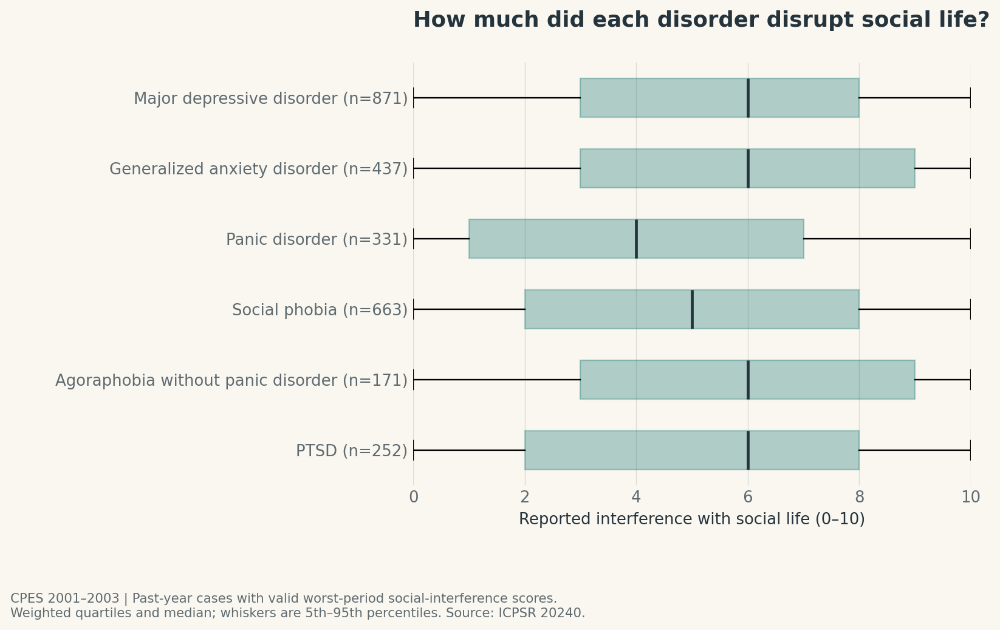

# Mental disorders, daily-life interference, and reported care

Judy Chen

## What is your current goal? Has it changed since the proposal?

My goal remains to explore the prevalence of selected mental disorders, how they interfere
with daily life, and how reported care varies with disorder type and functional burden.
CPES 2001–2003 is the main source; NSDUH 2024 provides a separate contemporary depression section.
I have expanded the development plan to 13 figures, adding UpSet, alluvial, and waffle charts.
I will select 8–12 images for the milestone submission after reviewing the complete set.

**Current status:** this folder is a notebook starter, not the completed milestone.
Four real-data figures are available; Figures 5–13 are planned.

## Are there data challenges you are facing? Are you currently depending on mock data?

Both complete public-use files are available locally, and no mock data are used.
CPES has 20,013 rows and 5,543 columns; the official paired analysis pool has 10,341 respondents.
NSDUH has 58,633 rows and 2,632 columns, including 47,299 adults and 5,205 with past-year depression.

The remaining challenges include reconstructing CPES treatment skips, checking impairment
missingness, and completing the remaining uncertainty calculations. NSDUH has 197 adults
with past-year depression whose responses to the two care questions are not both known;
they must not automatically be classified as untreated. The sources have different instruments
and definitions, so I will not present them as a direct historical trend.

Respondent-level files remain outside version control. Acquisition and execution instructions
are in [README.md](README.md) and [data/README.md](data/README.md).

## Describe each of the provided images with 2-3 sentences to give the context and how it relates to your goal.

### Figure 01: Prevalence of selected disorders

This figure introduces the weighted past-year prevalence of the six selected disorders in the shared CPES sample. The intervals reflect the sampling design, and the groups overlap because a respondent can meet criteria for several disorders.

### Figure 02: Pairwise co-occurrence

Each row asks how often adults with that disorder also met criteria for the column disorder. This shows pairwise overlap and explains why the prevalence percentages cannot be added to count distinct people.

### Figure 03: Exact disorder combinations

The connected dots identify exact combinations of the six selected disorders, and the bars show their weighted shares among adults with at least one selected disorder. This extends the overlap story beyond pairs; a single filled dot excludes only the other five selected disorders.

### Figure 04: Social-life interference

The boxplots compare the weighted distribution of social-life interference during each disorder’s worst period in the past year. They show functional burden and its variation, using only valid 0–10 responses rather than interpreting missing values as no interference.

### Remaining planned figures

These sections are organized in the notebook but do not yet have rendered images.

| Figure | Planned image | Purpose |
|---|---|---|
| 05 | Domains of daily-life interference (Heatmap) | How did home management, relationships, and social-life interference compare? |
| 06 | Disorder-specific professional care (Dot-and-interval plot) | What share of each disorder group reported professional help for that disorder? |
| 07 | Reported medication classes (Heatmap) | Which medication classes did adults in each disorder group report? |
| 08 | Interference and antidepressant use (Point-and-line plot) | Within depression, how did antidepressant use vary across interference bands? |
| 09 | Burden and professional care (Scatterplot) | Did greater average social-life interference coincide with more reported care? |
| 10 | Depression-related care combinations in 2024 (100% stacked bars) | How did professional contact and medication combinations vary with severe impairment? |
| 11 | Impairment, insurance, and reported care (Alluvial diagram) | How did impairment, insurance, and care categories occur together? |
| 12 | Insurance differences in reported care (Dot-and-interval plot) | Among adults with severe impairment, did neither-care rates differ by insurance? |
| 13 | Care out of 100 (Waffle chart) | What share of the severe-impairment group reported neither care form? |

## What form do you envision your final narrative taking? (e.g. An article incorporating the images? A poster? An infographic?)

I envision an HTML or PDF article moving from prevalence and overlap to daily-life burden,
reported care, and a separately labeled 2024 section about depression and insurance.
The final figures will use a consistent custom theme and remain understandable in print.

## Data sources

- [Collaborative Psychiatric Epidemiology Surveys (CPES), 2001–2003, ICPSR 20240](https://www.icpsr.umich.edu/web/ICPSR/studies/20240).
- [National Survey on Drug Use and Health (NSDUH), 2024](https://www.samhsa.gov/data/data-we-collect/nsduh-national-survey-drug-use-and-health/datafiles/2024).
