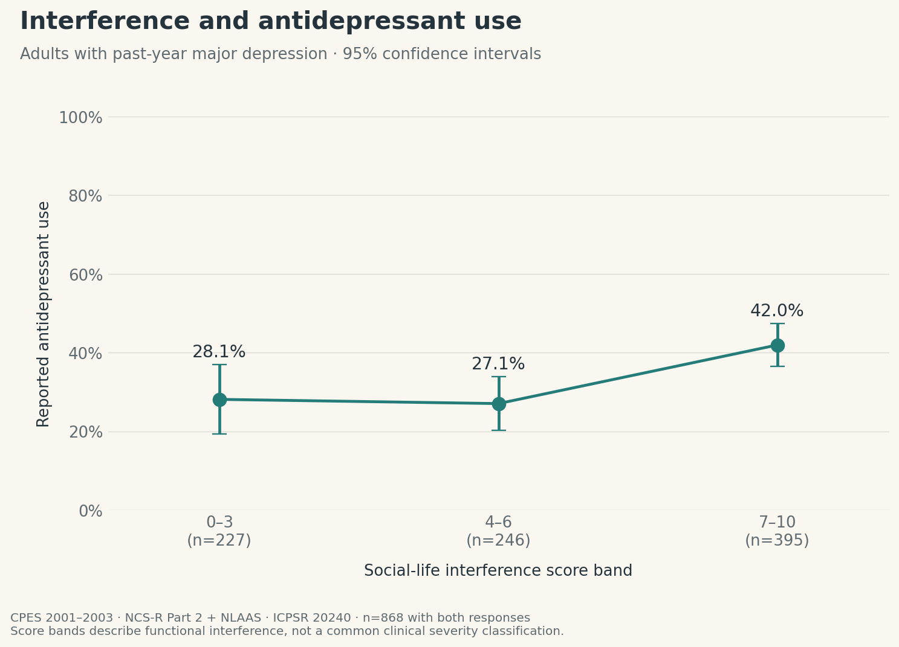
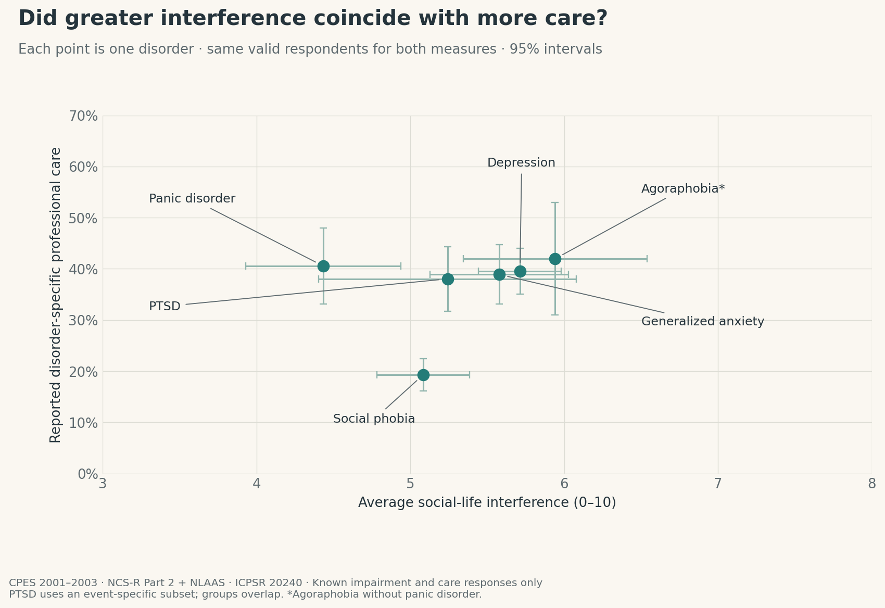
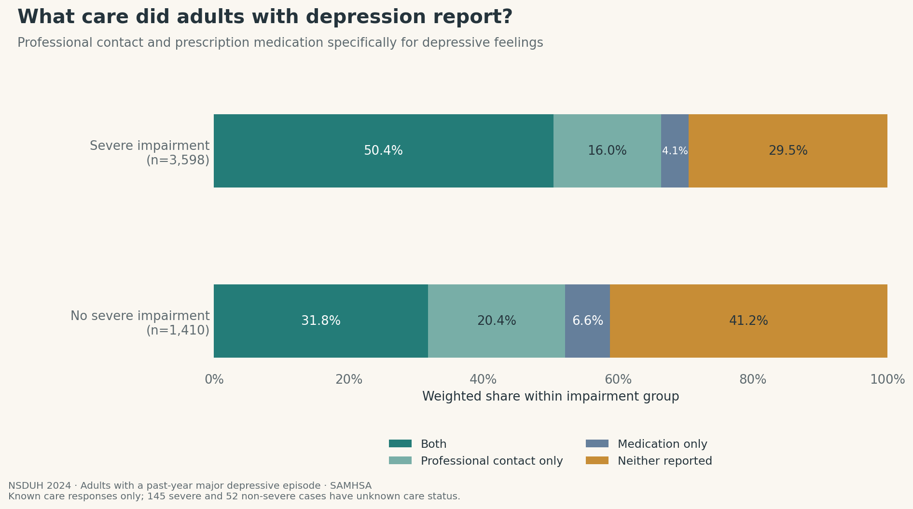
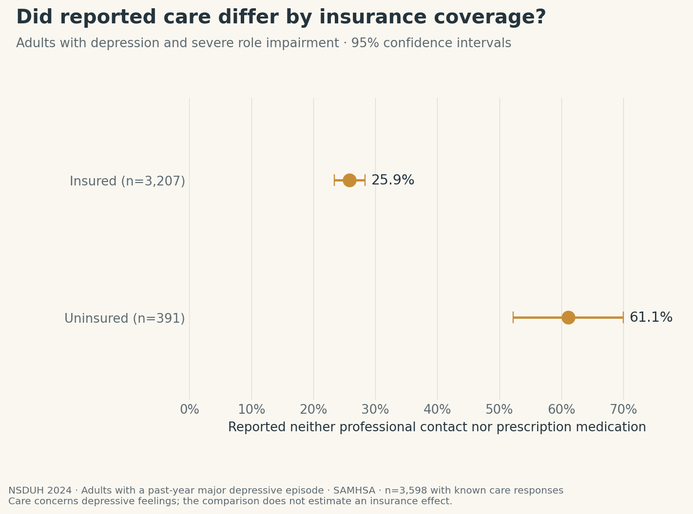
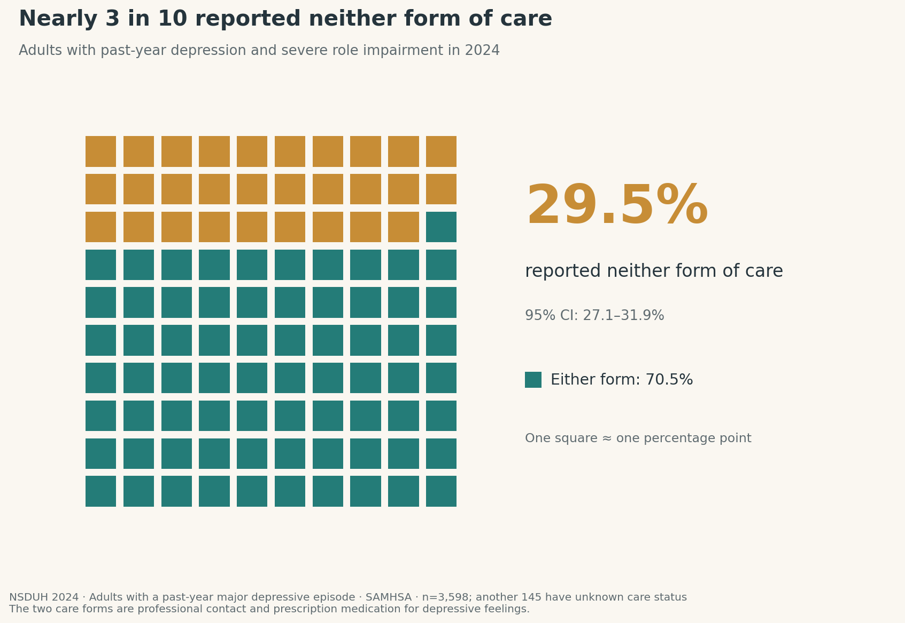

# Mental disorders, daily-life interference, and reported care

Judy Chen

## What is your current goal? Has it changed since the proposal?

My goal is still to explore the prevalence of selected mental disorders, their interference with daily life, and reported care. CPES 2001–2003 provides the main analysis, while NSDUH 2024 adds a separate section on depression, impairment, and insurance. I developed 13 figures and selected 12 below; Figure 02 is an additional comparison in the notebook.

## Are there data challenges you are facing? Are you currently depending on mock data?

All figures use real data. CPES contains 20,013 respondents, with 10,341 in the shared analysis pool; NSDUH contains 58,633 respondents, including 5,205 adults with past-year depression.

The main challenges are questionnaire skips and missing responses. PTSD care and interference questions cover a narrower response subset, so those results cannot be generalized to every PTSD case. NSDUH has 197 depression cases with unknown care status, including 145 with severe impairment. The two surveys use different instruments and are not a direct historical trend.

## Describe each of the provided images with 2-3 sentences to give the context and how it relates to your goal.

### Figure 01: Past-year prevalence

Major depression and social phobia had the highest prevalence among the six selected disorders. These overlapping groups introduce the scale of the historical mental-health burden.

### Figure 03: Comorbid disorder combinations

This plot shows the ten most common exact combinations among 754 respondents with at least two of the selected disorders. It focuses on comorbidity, with connected dots identifying the disorders included in each combination.

### Figure 04: Social-life interference distributions

Each panel shows the weighted share reporting each social-life interference score from 0 to 10. This reveals variation within disorder groups that a single average would hide.

### Figure 05: Daily-life domains

The heatmap compares average interference across home management, close relationships, and social life using complete responses in all three domains. Social phobia, for example, showed greater interference with social life than with home management.

### Figure 06: Disorder-specific professional care

Reported past-year professional care was lower for social phobia than for the other selected disorders. The labels show how many cases had known care status, with PTSD representing a narrower event-specific response subset.

### Figure 07: Medication classes

Antidepressants were the most frequently reported of these medication classes within each disorder group. The chart does not identify the prescribing indication, and gray cells omit estimates with too few reported users or insufficient precision.

### Figure 08: Interference and antidepressant use

Among adults with major depression, antidepressant use was higher in the 7–10 interference band than in the two lower bands. This addresses how reported medication use varied with functional burden.

### Figure 09: Interference and professional care

This scatterplot places average social-life interference alongside professional care for the same valid respondents within each disorder group. It summarizes the burden-and-care relationship without treating the overlapping groups as independent or establishing causality.

### Figure 10: Depression-related care in 2024

The bars compare professional contact and prescription medication for depressive feelings among adults with and without severe role impairment. Neither form was reported by 29.5% of the severe-impairment group and 41.2% of the group without severe impairment.

### Figure 11: Impairment, insurance, and care

The ribbons connect impairment, insurance, and reported care categories within the same analysis population. Their widths show population shares rather than within-group rates, providing context for the insurance comparison below.

### Figure 12: Insurance and reported care

Among adults with depression and severe impairment, 61.1% of uninsured adults reported neither care form, compared with 25.9% of insured adults. Confidence intervals show uncertainty, and the comparison describes an association rather than an insurance effect.

### Figure 13: Care out of 100

The closing figure emphasizes that 29.5% of adults with depression and severe impairment reported neither of these two care forms. This does not establish an absence of all support or a validated measure of unmet need.

## What form do you envision your final narrative taking? (e.g. An article incorporating the images? A poster? An infographic?)

An HTML or PDF article moving from prevalence and overlap to interference and care, followed by a separately labeled 2024 section on depression and insurance.

Sources: [CPES, ICPSR 20240](https://www.icpsr.umich.edu/web/ICPSR/studies/20240) and [NSDUH 2024](https://www.samhsa.gov/data/data-we-collect/nsduh-national-survey-drug-use-and-health/datafiles/2024). Code and local-data instructions are in the [notebook](static-draft.ipynb) and [README](README.md).
