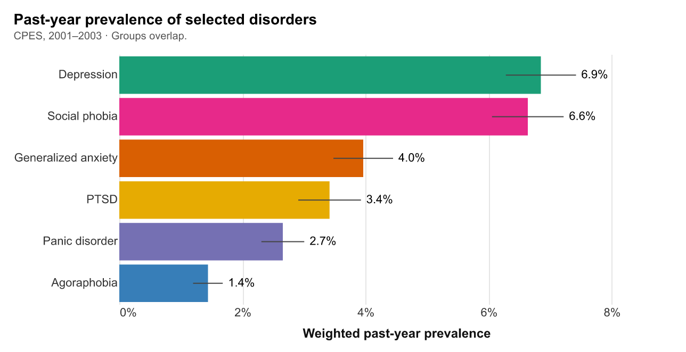
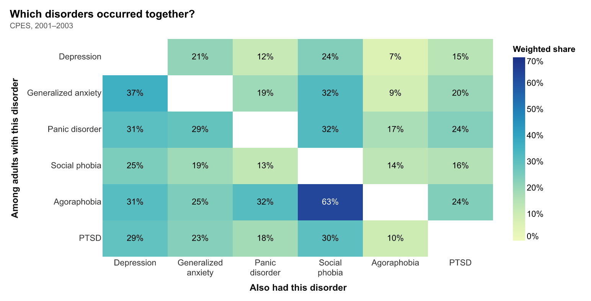
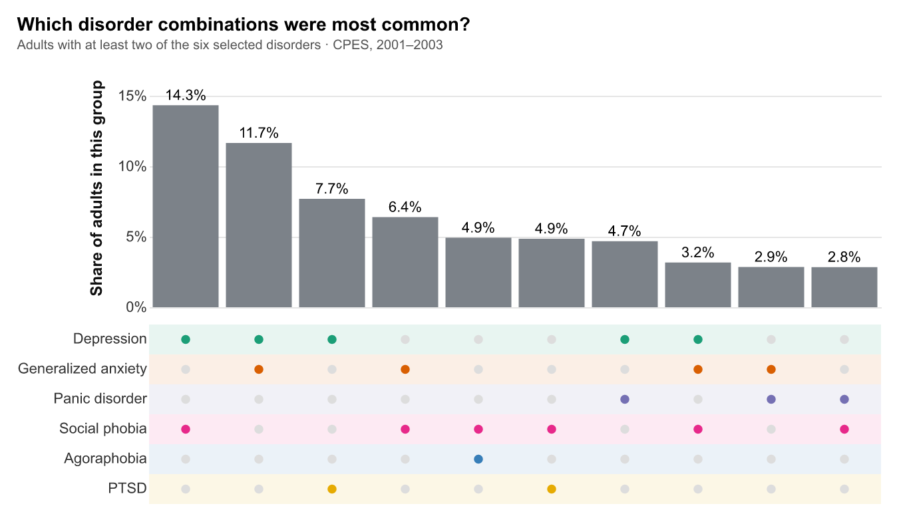
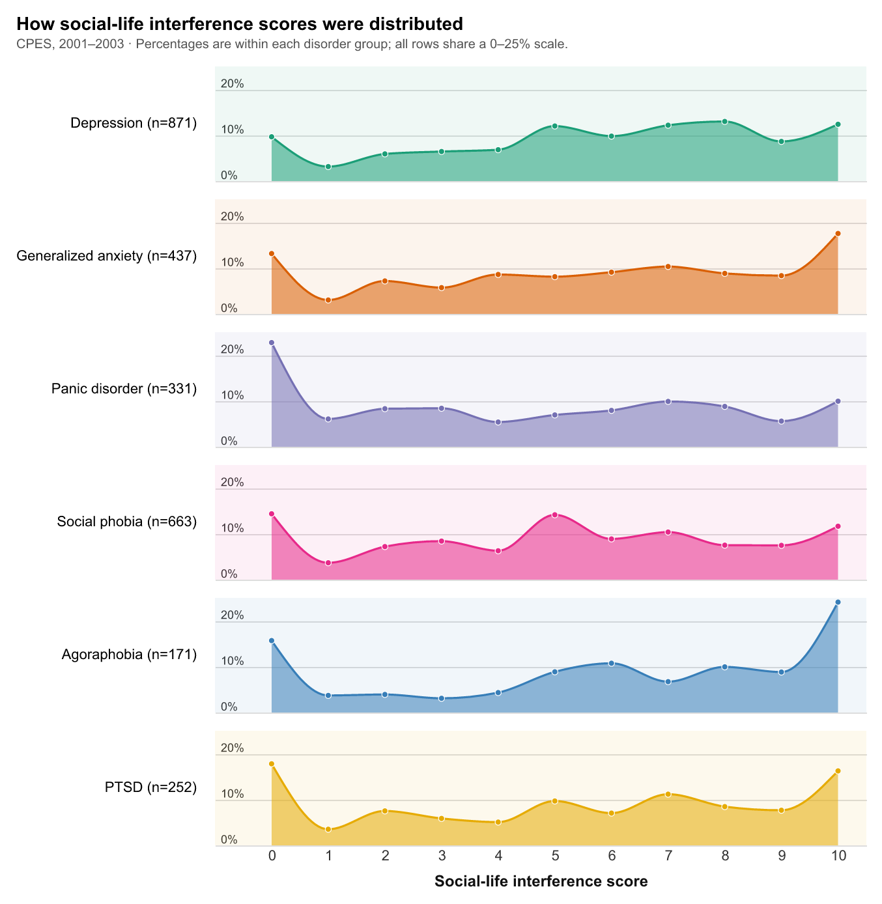
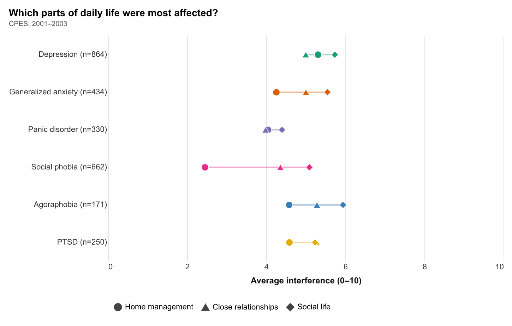
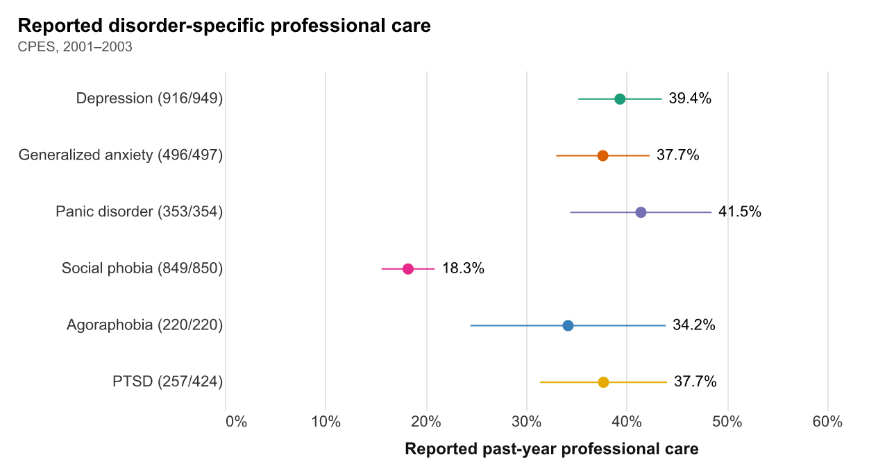
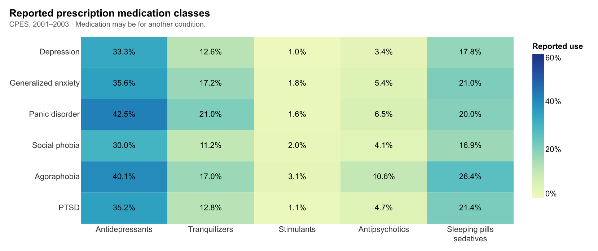
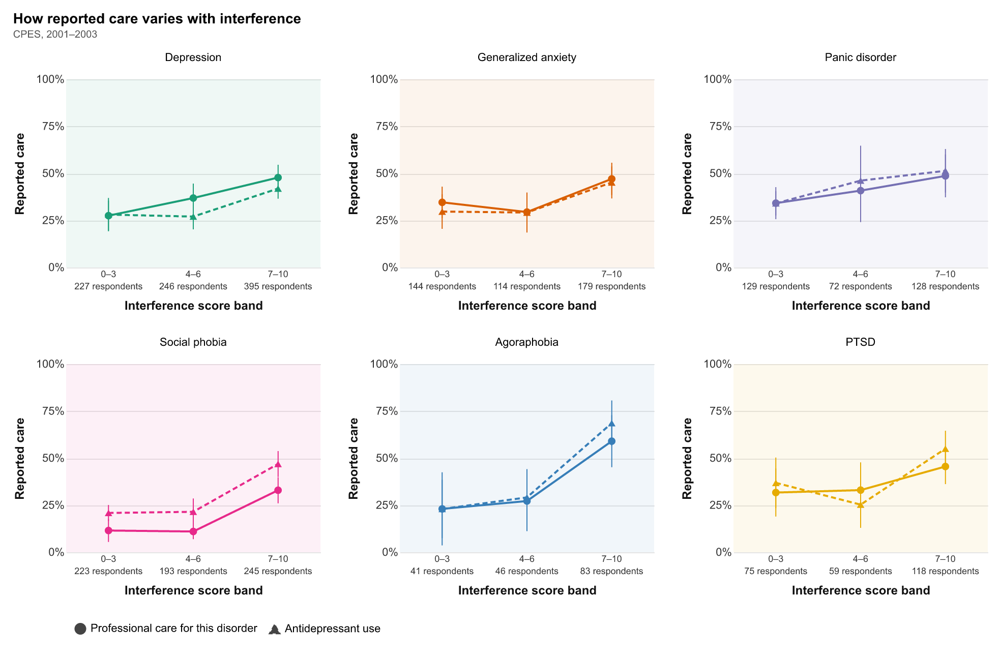
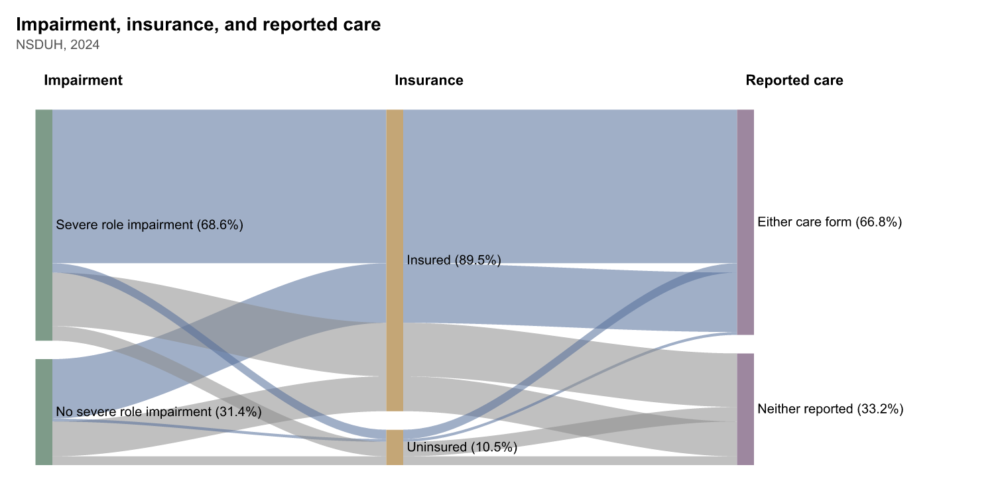

# Mental disorders, daily-life interference, and reported care

Judy Chen

## What is your current goal? Has it changed since the proposal?

My goal is still to compare six mental disorders: how common they were, how much they interfered with daily life, and what care people reported. Most figures use CPES from 2001–2003. The last three use NSDUH 2024 to look at depression more recently, because it asks about depression, impairment, and care together.

## Are there data challenges you are facing? Are you currently depending on mock data?

All 11 figures use real data. CPES has 20,013 respondents, and I use the 10,341 in the NCS-R Part 2 + NLAAS sample. NSDUH has 58,633 respondents, including 5,205 adults with past-year depression.

The main challenges are skipped questions and missing answers. PTSD care and interference questions cover a smaller, event-specific group. In NSDUH, 197 respondents with depression have unknown care status and are excluded, leaving 5,008. I analyze the surveys separately because their questionnaires differ.

Percentages and averages use survey weights; n counts respondents, and error bars show 95% confidence intervals. Interference scores run from 0 (none) to 10 (very severe) and describe the worst period of the past year. Here, agoraphobia refers to the diagnosis without panic disorder.

## Describe each of the provided images with 2-3 sentences to give the context and how it relates to your goal.

### Figure 1: Past-year prevalence

Depression and social phobia were the most common of the six disorders. This gives a starting point for comparing how many people were affected and what care they reported.

### Figure 2: Which disorders occurred together?

Each row starts with people who had one disorder and shows what percentage also had each other disorder. The percentages differ across the diagonal because each row starts with a different group of people. This shows common overlaps before the next figure breaks down exact combinations.

### Figure 3: Which disorder combinations were most common?

This shows the ten most common exact combinations among 754 respondents with at least two selected disorders; the remaining combinations account for 36.5%. Colored dots show which disorders belong to each combination. For example, the first bar represents depression and social phobia without any of the other four selected disorders.

### Figure 4: Social-life interference distributions

These rows show how social-life interference scores were spread within each disorder. Dots show the percentages at scores 0–10, and curves help show the shape between them; every row uses the same percentage scale.

### Figure 5: Daily-life domains

This compares average interference with home management, close relationships, and social life for each disorder. The lines connect the lowest and highest domain averages, rather than showing uncertainty. For social phobia, social life was more affected than home management, with average scores of 5.1 and 2.5.

### Figure 6: Disorder-specific professional care

Among respondents with known care answers, this shows the percentage who reported professional help for their disorder in the past year. Social phobia had the lowest reported rate of care.

### Figure 7: Medication classes

Antidepressants were the most frequently reported medication class in all six groups. People may have used medication for another condition, so this does not tell us what each prescription was for. Some medication categories have few reported users.

### Figure 8: Interference and reported care

Each disorder is split into three social-life interference groups, with the respondent count below each score range. Circles show professional help and triangles show antidepressant use for the same people in each group. Both were reported more often in the highest score group than in the lowest for all six disorders.

### Figure 9: Depression-related care in 2024

These bars show the combinations of professional contact and prescription medication reported for depressive feelings among adults with past-year depression in 2024. Neither was reported by 29.5% of those with severe impairment and 41.2% of those without severe impairment.

### Figure 10: Insurance and reported care

Among adults with depression and severe impairment, 61.1% of uninsured adults reported neither care form, compared with 25.9% of insured adults. This compares two groups; it does not show that insurance caused the difference.

### Figure 11: Optional experiment — impairment, insurance, and care

These ribbons connect impairment, insurance, and reported care for the same people. Their widths show shares of the full sample, so they should not be read as treatment rates within each group. I am treating this as an experiment because the crossing ribbons can be hard to follow.

## What form do you envision your final narrative taking? (e.g. An article incorporating the images? A poster? An infographic?)

I plan to make an HTML or PDF article, starting with how common the disorders were and how often they overlapped, then moving to daily-life interference and care. A short final section will look at depression in 2024.

Sources: [CPES](https://www.icpsr.umich.edu/web/ICPSR/studies/20240) and [NSDUH 2024](https://www.samhsa.gov/data/data-we-collect/nsduh-national-survey-drug-use-and-health/datafiles/2024). The [notebook](../src/static_viz.ipynb) contains the code and run instructions; [data/README.md](../data/README.md) lists the source files.
